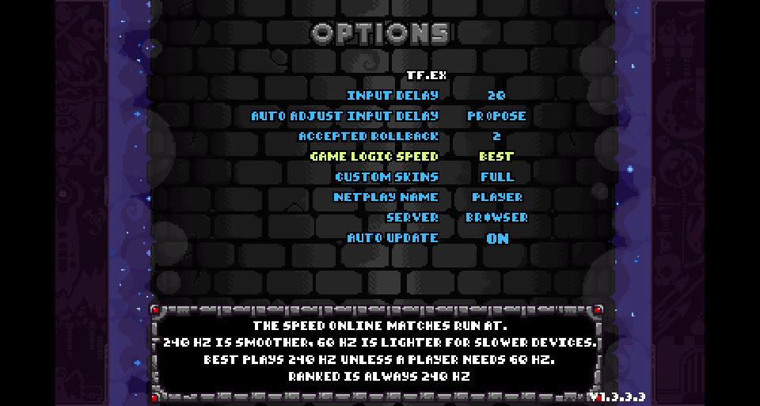
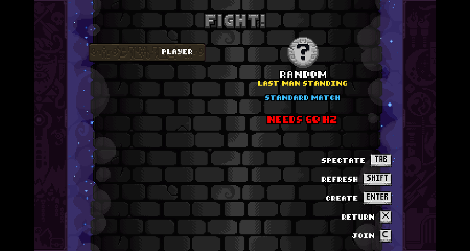
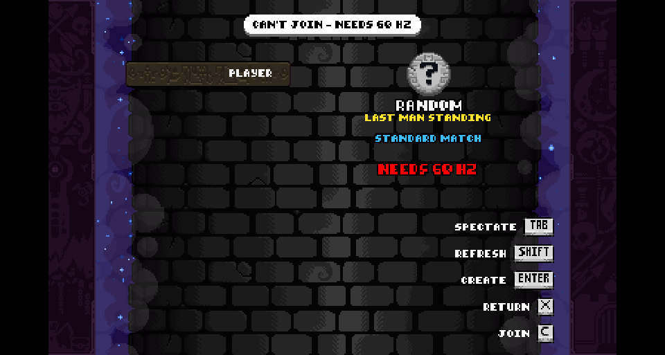
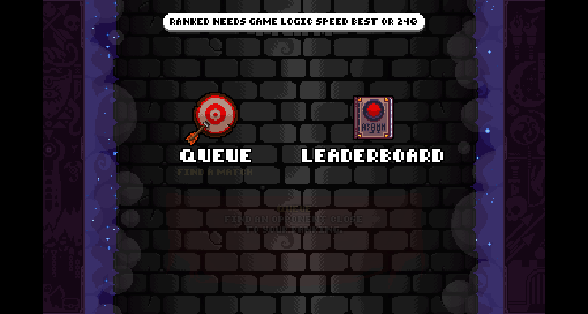
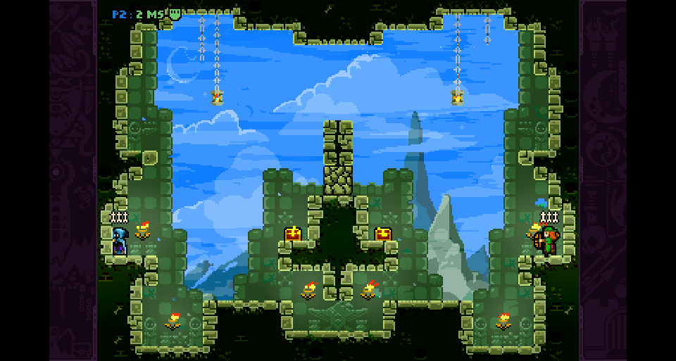
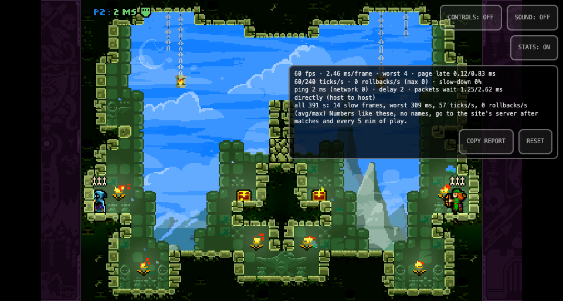
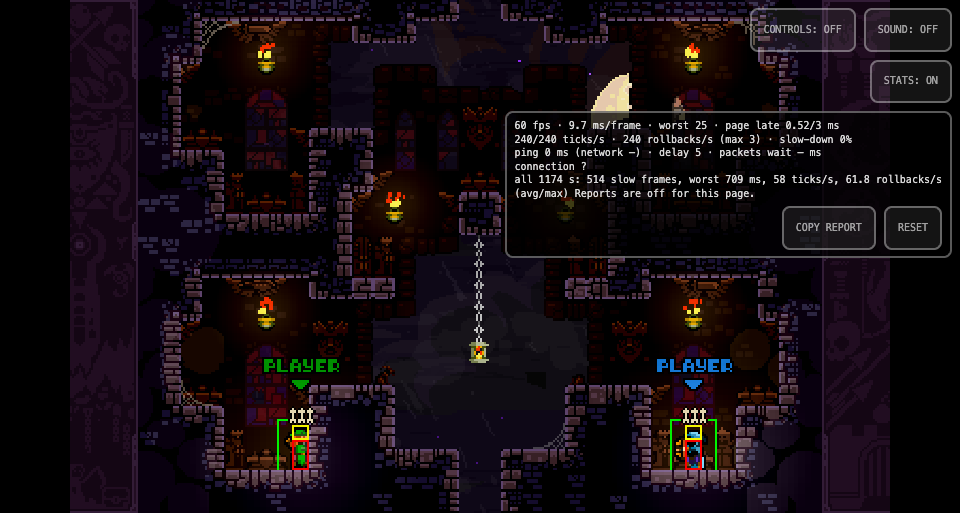

# Game Logic Speed (60 Hz / 240 Hz / Best for all): design draft

A TF.EX fork feature (belacmu/TF.EX, a new branch off the pinned base): a netplay setting that picks the rate the online match
simulates at, carried into lobbies and Quick Play so a player sees whether a lobby fits their choice. Status (2026-11-04): built on
the fork and played in two browser pages (see "Built" and "Played" at the end). Not going to the Switch or the browser on our
fork pin (the user, 2026-11-04: it can wait for upstream); the branches wait for the upstream PR, which isn't due yet.
Pushed (2026-11-04), no PRs: belacmu/TF.EX `game-logic-speed` (on Fcornaire/TF.EX main 3d98d2e) and
belacmu/tf-ex-matchmaking-server `game-logic-speed` (on Fcornaire's main 0ea22a3). Squash each before the PR.

## Why
Every online match runs at TF.EX's 240 Hz (`Constants.NETPLAY_FPS`, since TF.EX bb979dc). Weaker devices can't keep it: on the
console 3+ players cost more than 240 Hz's 4.17 ms budget and the catch-up spirals (STATUS.md, "the road to EIGHT players"); the
smooth console matches of 2026-10 were the 60 Hz ones (5b590b3e).

## What TF.EX already has (v0.29.0)
- **The session rate is already a per-session value**, not only a constant: `GGRSConfig.Fps` (default `NETPLAY_FPS`),
  `INetplayManager.GetSessionFps()`, and `TFGamePatch` (TFGame.cs ~894) sets `TargetElapsedTime = round(1e7 / fps)` for a
  session whose rate isn't 240. Only test mode uses it today (`StartTestMode(..., fps)`, `TFCommands` passes `VANILLA_FPS`).
- **Replays already record their rate** (`ReplayInfo.TickRate`, `LegacyTickRate = 60`; `ReplayService.EnsurePlaybackTickRate`).
- Game logic scales by `Engine.TimeMult` (0.25 at 240), so 60 Hz is the vanilla game, not a new mode.
- Still hard-wired to 240 (must read the session rate instead): `NetplayPreferences.ToFrames` (input delay ms -> ticks),
  `Constants.MAX_PREDICTION_TICKS`, `SPECTATOR_CATCHUP_THRESHOLD`, `InputDelayAdvisor.FrameMs`, `InstantReplayFootage.TickSeconds` /
  `HalfSpeedFootageTicks`, the `2 * NETPLAY_FPS` frames-behind checks (GameplayLayer.cs:55, NetplayManager.cs:446), TFGame's
  `DELAYED_CATCHUP_THRESHOLD`.

## The two precedents to copy
| | Instant Replay | WiderSet (wide mode) |
|---|---|---|
| Setting | the game's own Replay option (`NetplayOptions.UseInstantReplay`) | the WiderSet mod's `IsWide` |
| In the lobby | per player: `Player.UseInstantReplay` (server copies the owner's to local guests, lobby.rs:816) | lobby level: `Lobby.Mods` entry `Teuria.WiderSet {IsWide}` |
| Resolution | at `Session.StartGame`: on only if **every** player has it (`lobby.Players.All(...)`) | none: must match |
| Lobby list | nothing shown | `CanJoin = false`, `CanNotJoinReason = "WIDERSET MOD ON OFF REQUIRED"` (MainMenu.cs ~1897) |
| Quick Play / Ranked | not involved | `EnterQuickPlay.is_wide`; server only pairs equal `is_wide` (quickplay.rs `nearest_open_quick_play`, the queue partner filter) and shows queue counts split standard / wide (`QueueCounts`) |

Game Logic Speed is both: a per-player choice resolved by everyone the same way (Instant Replay), with a hard mismatch between
"60" and "240" that the lobby list and the Quick Play matcher must respect (WiderSet).

## Proposed shape
1. **Setting** (`NetplaySettings`, an options row like CUSTOM SKINS): `GAME LOGIC SPEED` = `BEST` | `240 HZ` | `60 HZ`, into
   `NetplayPreferences.GameLogicSpeed`. Default `BEST` (decided 2026-11-03, the user): a weak device's 60 pulls the lobby down
   instead of locking it out. Help text: what each does; 60 HZ for devices that slow down online.
2. **Per player in the lobby:** `Player.GameLogicSpeed` (string, like `Platform`), set wherever `UseInstantReplay` is set
   (RollCallElement.cs:100/268, MainMenu.cs:713/2157). Server: a `#[serde(default)] game_logic_speed` on `Player`, copied to
   local guests with the other owner fields. Missing/empty = `240` (an older TF.EX only runs 240), so old clients stay compatible.
3. **Lobby rate (one pure function, used by client and server):** any player `60` -> 60; otherwise 240 (all `BEST`, or some
   `240`). A `60` and a `240` player never share a lobby. `BEST` joins anything and takes the lobby's rate. `BEST` only means "accept either" (decided 2026-11-03, the user):
   no automatic device detection; that could come later as a device reporting `60`, without changing the matching.
4. **Session:** the rate is resolved from `lobby.SessionPlayers` where the GGRS config is built for a lobby match (before the
   session starts, since the prediction window and input delay depend on it) into `GGRSConfig.Fps`; TFGame's existing step code
   does the rest. Every peer computes the same value from the same lobby, so no new message. Spectators read it from the lobby.
5. **Lobby list:** in the same check chain as WiderSet, on the client only (as upstream does wide mode in lobbies):
   `CanJoin = false`, `NEEDS 60 HZ` (or 240) when the joiner's fixed choice clashes with the lobby. The speed reaches the server
   with the rest of the player through the player update, as Instant Replay's does; the server doesn't check lobby joins (a stale
   list can't break a match: every peer still computes "any 60 -> 60").
6. **Ranked always runs at 240** (decided 2026-11-03, the user: ratings compare like with like): a `60 HZ` player can't enter
   Ranked (the RANKED entry says why); `BEST` plays it at 240; the Ranked matcher is unchanged.
   **Quick Play:** `EnterQuickPlay.game_logic_speed` beside `is_wide`, matched by the server as it matches wide mode: two queued
   players fit when their choices are compatible (equal, or either `BEST`); an open Quick Play lobby fits when the joiner is
   compatible with it. The queue counts stay upstream's.
7. **The 240-only constants** above become functions of the session rate.

## How the player sees it
Only where the speed stops a player (decided 2026-11-04, the user: no more information than needed). The lobby, the roll call,
the lobby feed and Quick Play show nothing about it: a BEST player plays either speed, and a fixed player only needs to know
when a lobby or Ranked won't take them.

| Where | What |
|---|---|
| NETPLAY settings (MODS > TF.EX) | `GAME LOGIC SPEED  BEST / 240 HZ / 60 HZ`, with help text |
| Lobby browser, selected lobby's panel | a fixed player on a lobby with the other fixed speed: the red can't-join line `NEEDS 60 HZ` (or 240); joining: `CAN'T JOIN - NEEDS 60 HZ` |
| Ranked entry | a `60 HZ` player pressing QUEUE: notification `RANKED NEEDS GAME LOGIC SPEED BEST OR 240` |

An earlier draft also showed the lobby's speed in the roll call and the lobby panel, a tag under fixed players, `JOINING SETS 60 HZ`,
`NOW 60 HZ` in the lobby feed and per-speed Quick Play counts; all removed (2026-11-04).

## Ports
- **Switch:** takes TF.EX's code through the translator (gen/), no Switch rule. ba3d0b9e/63dc33c0 are the earlier hand version
  (a 60 HZ MODE OPTIONS toggle + the browser's "lobby with a browser runs 60" rule), removed because TF.EX had no rate setting; the
  60 Hz desync fix (cf6ff9ff: the step is `round(1e7/hz)`) is TF.EX's code already. Check the glue's ms -> ticks conversion uses
  the session rate. The OPTIONS screen gets the row from FortRise's settings like the others.
- **Browser:** runs the same TF.EX code; follows the fork once it moves off the official release.
- **Server:** our fork (tf-ex-matchmaking-server, branch switch-online) for the field, the join check and the matcher. The
  official server drops the unknown field, so the feature only works on our server until upstream takes it.

## Tests
smoke lobby at 60 Hz and at 240 (TF.State saved bytes identical; vsstop counts ticks, so 60 Hz needs 1/4 of the ticks for the same
game time); one mixed case (BEST + 60 resolves to 60 on both sides); server unit tests for the matcher and the join check.

## Built (2026-11-03)
Fork branches, both on upstream's latest main (the author asks for that), commits without Claude lines (upstream-bound):
- TF.EX: `~/Code/Towerfall Switch Mods/tfex-game-logic-speed`, branch `game-logic-speed` on Fcornaire/TF.EX main 3d98d2e
  (remotes: origin belacmu, upstream Fcornaire). 68a5f35 the setting, the player field, the lobby's rate, the session (one path:
  `NetplayManager.GetSessionFps()` follows the lobby until the session starts, then `GGRSConfig.Fps`; every 240-only value now
  takes the session rate); ff58243 the screens; d7987c7 joins send the speed. Builds with
  `dotnet build src/network/TF.EX.Core/TF.EX.Core.csproj -c Release -p:ModLoaderPath=$PWD/libs -p:ModEnablePublish=false -p:ModEnableZip=false`.
- Server: `~/Code/Towerfall Switch Mods/tf-ex-mm-game-logic-speed`, branch `game-logic-speed` on Fcornaire main 0ea22a3
  (remotes: origin Fcornaire, belacmu). 17ed586: `Player.game_logic_speed`, the speed on JoinLobby / JoinPrivate /
  EnterQuickPlay, the check in `seat_member` (every join goes through it), Quick Play pairs and fills only compatible speeds,
  `QuickPlayStatus.searching_hz60/hz240`. `cargo test`: 56 passed (new: the matching test, the compatibility rule).
- Changes from the draft above: the engine step goes back to FortRise's 240 (`EnableFixedTimeStep(true)`) after a 60 Hz
  session (TF.EX only set a non-240 step and never undid it); the input delay advisor counts ticks at the lobby's rate and starts
  over when the rate changes; the 240-only constants became `Constants.MaxPredictionTicks(fps)` / `SpectatorCatchupThreshold(fps)`.
  The native GGRS library already scales its prediction window by the configured fps.
- Not done: BEST doesn't prefer a 240 partner (nearest still wins).
- 4d41e4d (after the first play test): the help text fits (its 3rd line wrapped), and Quick Play's `N PLAYERS SEARCHING` leaves
  out the players of the other fixed speed (it counted them). Server ba54f58: the join check's test (60 into a 240 lobby refused,
  a spectator and BEST let in). `cargo test`: 57 passed.

## Played (2026-11-03, two browser pages)
Pages built from the fork (`TFEX_SRC=<fork> tools/modmodes/build-page.sh .devserve/gamespeed`, browser worktree tfex-0281) on
the fork server. Upstream's server refuses every browser origin, so the test binary is branch `game-logic-speed-test` = the
feature + our fork's ALLOWED_ORIGINS commit (7810329, cherry-picked; not for the PR). Settings set by the menus (MODS > TF.EX >
GAME LOGIC SPEED: confirm cycles BEST > 240 HZ > 60 HZ).
- 60 HZ host + BEST joiner: both lobbies show 60 HZ, the tag only under the 60 HZ player; the match plays at 60 ticks/s on both
  (STATS panel: `60/240 ticks/s`, input delay 2 ticks = 33 ms), no desync line on either page, past round 2.
- BEST host (240 HZ lobby, input delay 5 ticks) + 60 HZ joiner: the list shows `JOINING SETS 60 HZ`; on joining the host's feed
  shows `LOBBY SETTINGS UPDATED` / `NOW 60 HZ`, the corner turns 60 HZ, the delay is re-counted (33 ms); the match runs 60/240
  ticks/s on both, no desync.
- 240 HZ page on a 60 HZ lobby: red `NEEDS 60 HZ`, joining gives `CAN'T JOIN - NEEDS 60 HZ`, no join reaches the server.
- Quick Play 60 HZ + 240 HZ: the server queues `speed: Hz60` / `Hz240` and doesn't pair them (the "other speed" line shown then
  was removed after the review, below).
- RANKED > QUEUE at 60 HZ: `RANKED NEEDS GAME LOGIC SPEED BEST OR 240`, not queued.
- The step back to 240 after a 60 Hz session, same page (one page, `towerfallCommand` in the page): `scenario 0 600` runs TF.EX's
  whole scenario catalog in sync test at 60 Hz (all 82 PASS, coverage 40/40, then back to the menu), then `test LMS 0 0 42 2`
  (TF.EX's sync test at 240): the STATS panel shows `240/240 ticks/s` (the session average 58 is the 60 Hz sweep before it), no
  `Sync test desync detected`, no exception. Without the TFGamePatch reset the engine would have kept the sweep's 60 Hz step.
- Seen, not from this change: CONTINUE on the round results after the opponent left (DISCONNECTED) crashed the page with
  `FileNotFoundException ... Levels\Versus\11 - Ascension\07.oel` in vanilla `Session.GotoNextRound` > `GetNextRoundLevel`
  (none of the speed code on the stack). To look at separately.
- Screenshots: the section below (docs/img/game-logic-speed/).

- Checked against TF.EX's author's feedback (STATUS / the #314 and #312 reviews): one path for the rate, explicit string values on
  the wire (`Best` / `Hz240` / `Hz60`, empty = a client from before, 240), no needless comments, changelog under [Unreleased],
  on his latest main. The design wasn't agreed with him first (the user chose to build on the fork first).

## Screenshots
Two browser pages on the fork, 2026-11-04 (08: 2026-11-03). The test driver's screenshots leave out the page's own buttons
(browser repo `tools/netplay-driver.mjs`: `/shot` hides `#corner`, `/shot?page` keeps it).

The setting in MODS > TF.EX, on its default BEST, with its help text.

Set to 60 HZ (confirm cycles BEST > 240 HZ > 60 HZ).

A 240 HZ player on a 60 HZ player's lobby: NEEDS 60 HZ.

Joining it anyway: CAN'T JOIN - NEEDS 60 HZ.

RANKED > QUEUE at 60 HZ.

A 60 HZ player joined a BEST host's lobby: the match plays at 60 Hz.

The page's STATS panel in that match (a page screenshot, with the page's buttons): 60 ticks/s, no rollbacks.

Same page after a 60 Hz scenario sweep: TF.EX's 240 Hz sync test runs at 240 ticks/s (the step goes back to 240).

## Independent review (2026-11-03)
A separate agent reviewed both branches against FCornaire's own code and history. Fixed (TF.EX 2cbcbd4, server c4dfc3b):
- Replays of a 60 Hz match recorded `TickRate = 240`: `BeginRecording` runs right after `Init`, and FortRise's
  `EnableFixedTimeStep(true)` always sets 1/240 s before `CurrentTickRate()` reads it (upstream's 60 FPS test mode had the same
  bug). `BeginRecording` now takes an optional `tickRate` (both `ITfReplayApi` copies), filled from `GetSessionFps()`; the
  keyframe stride uses the recorded rate.
- Server: the speed is a serde enum like `LobbyKind` (`Option<GameLogicSpeed>`, None = a client before the setting = 240);
  `update_player` keeps the speed the player joined with (it could be changed after joining); Quick Play's status counts, per
  queued player, only the players they can be paired with, in the existing `searching_standard` / `searching_wide` (the
  `searching_hz60/hz240` fields and the client's "other speed" line are gone: they mixed wide and standard players).
- Client: a private-code join no longer checks the speed (the server does; spectators of any speed are fine); `Lobby` keeps only
  `TickRate` and `Accepts`; the extensions moved to `TF.EX.Domain/Extensions/`; the settings labels come from the enum; instant
  replay reads the rate once per match; a duplicated counter reset removed; the changelog entry is one line.
- Left: `GetSessionFps` reading the lobby before `Init` (fine, per the review); the series host's delay right after a rate change
  (republished, low risk). Deploy note: the server must be upgraded first.
- Re-run after the fixes: 60 HZ host + BEST joiner through the new server enum, both pages ~60 ticks/s, no desync; 57 server
  tests pass (one new: an update can't change the speed).

## Simplified (2026-11-04)
TF.EX 1d96a0d, server a6c8c38 (diffs from upstream: TF.EX 22 files +173/-38, server 6 files +206/-41, most of the server's in
tests).
- Shown only where it stops a player (table above).
- Lobbies as upstream's wide mode: checked by the client; the speed travels in the player update like `UseInstantReplay` (the
  `JoinLobby` / `JoinPrivate` fields, the server's join check and the update guard are gone). Quick Play keeps the server match
  (`EnterQuickPlay.game_logic_speed`, the queued player's speed set on their seat); the counts are upstream's again.
- Re-run on two pages: 60 HZ host, 240 HZ page refused; then a BEST host and a 60 HZ joiner: the host's input delay turned from
  21 to 33 ms when the joiner's update arrived, and the match ran at 60 ticks/s on both, no desync. Server tests: 56 pass.
- Before the PR: squash the branches' commits (each has a first version and refactors).

## Open questions
- Upstream: decided 2026-11-03, the user: build on the fork first, propose after.
