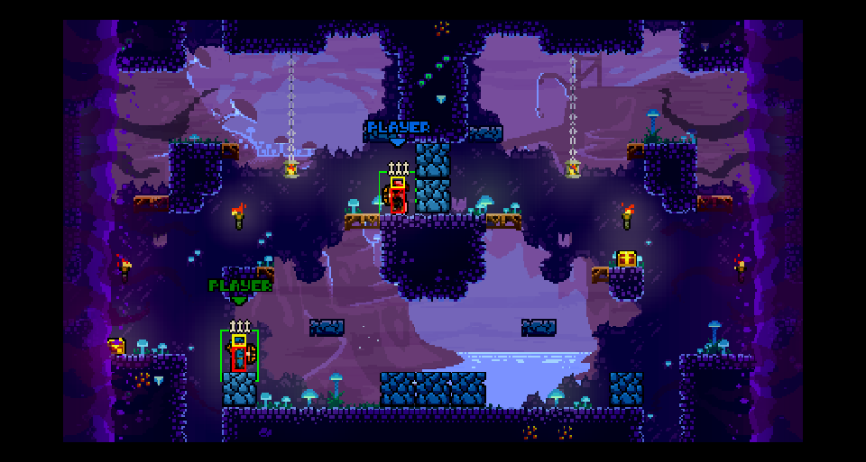
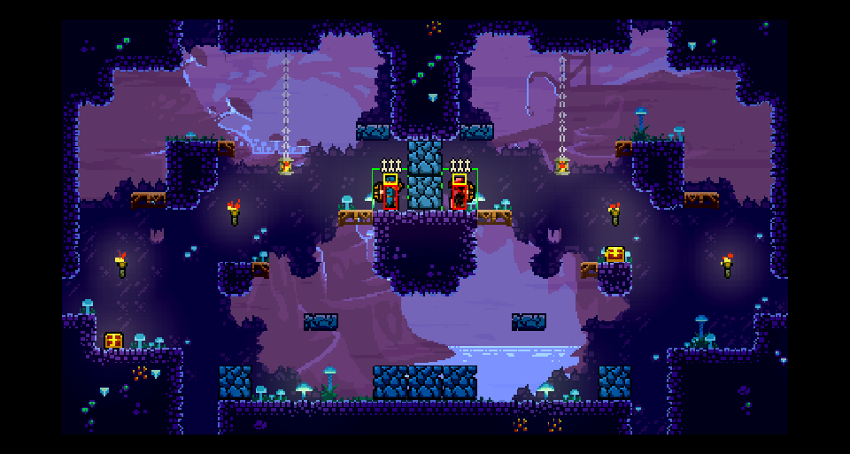

# Screenshots and before/after proof

How we take screenshots that prove a change, for upstream PRs (TF.EX, the server) and our docs. Learned on TF.EX PR C, the wide
spawn centre (2026-11-04).

## Rules
- **Prove only what was run.** A PR's "How it was tested" names the exact setup (build, command, level, players) and what the shot
  and the log show. Nothing from another branch or a bigger test (an 8-player run doesn't prove a 2-player claim).
- **Before and after differ only by the change.** Both builds come from the same commit except the change under test (upstream's
  main, then the PR branch), with the same test patches, the same command and the same level.
- **A log line backs every shot.** A picture shows *where*, a temporary log line shows *what the code chose* (positions, ids,
  counts). The log patch goes into both builds and never into the PR (`tools/pageshot/patches/`).
- **Check the shot shows the case.** Look at it before using it: the right level, the full width on a wide map (the level's art up to
  both edges, no plain background on one side), the moment you meant (not the menu before, not round 2).
- **Anything unexpected in a shot is a bug until proven otherwise.** Never hide or crop it away. Hide only what is known to be the
  page's own (the driver hides its buttons, `#corner`). (2026-11-04: a big controller outline over the 8-player roll call looked like
  the page's touch controls; it was our roll-call change drawing the PC atlas's `controls/gamepad`, the controls screen's diagram.)
- **Wait for the game to draw.** A command that loads a level holds the page in one long frame (35 s seen); a shot taken then
  shows the screen before it. Shoot once the page draws at 50+ frames/s again after the event's log line.
- **Pick a level where the bug shows**, from the level files, before running anything: compute what the old and new code choose
  for each level and run one where they differ.
- One browser page of our own at a time, a fresh profile per run; screenshots without the page's buttons (the driver's `/shot`).

## The tool: `tools/pageshot/shot.sh`
```
PAGESHOT_WIDE=1 PAGESHOT_PATCHES=team-spawn-log tools/pageshot/shot.sh before upstream/main "test TDM 0 2" '\[pageshot\] tower'
PAGESHOT_WIDE=1 PAGESHOT_PATCHES=team-spawn-log tools/pageshot/shot.sh after wide-spawn-centre "test TDM 0 2" '\[pageshot\] tower'
```
It builds a browser page from a TF.EX commit in a throwaway worktree (patches applied there), opens it headless, skips the
first-run tutorial, picks VERSUS > STANDARD or WIDER, runs a TF.EX console command, waits for the given log line and for the game to
draw, and saves `.devserve/pageshot/<name>.png` and the page's log. About 3 minutes a shot.
- TF.EX's `test <LMS|HH|TDM> <level> <tower> <seed> <check distance> <variants> <players>` runs one page as TF.EX's sync test: TF.State's
  code (the netplay path) without a second peer. Players stand still (no input).
- **Wide maps:** the test command loads the game's own towers even with WIDER picked (wide screen, standard level). The
  `wide-test-tower` patch makes it load WiderSet's tower of the same name (FortRise `TowerRegistry.VersusTowers`), at that level.
  Tower indexes: 0 Sacred Ground, 1 Twilight Spire, 2 Backfire, 3 Flight, 4 Mirage, 5 Thornwood, 6 Frostfang Keep, 7 Kings Court,
  8 Sunken City, 9 Moonstone, 10 TowerForge, 11 Ascension, 12 The Amaranth, 13 Dreadwood, 14 Darkfang, 15 Cataclysm.
- Patches: `wide-test-tower` (above), `team-spawn-log` (TF.State's team spawn choice). Add one per proof, kept small.

## In a PR
`gh pr create --attach` uploads images only to a repository we can write to. For an upstream PR: open a draft PR on our fork with
`--attach` (the body's `` becomes a `github.com/user-attachments/assets/...` URL, public for a public fork), close it,
and put those URLs in the upstream PR's body (TF.EX#316: belacmu/TF.EX#2 for the upload).

## Used for
- TF.EX PR C (wide spawn centre, Fcornaire/TF.EX#316): `docs/img/tfex-pr-c/`, Backfire's wide level 00, Team Deathmatch, 2 players: before blue x 100,
  red x 190 (both left of the centre, 210); after blue 190, red 230.




